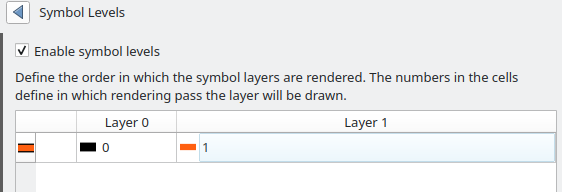
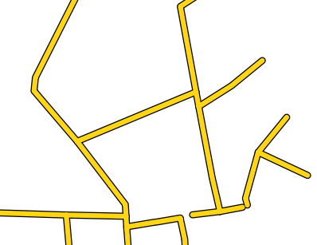
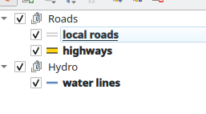
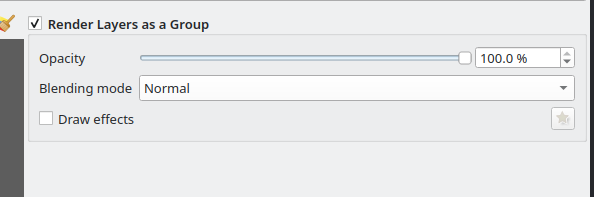
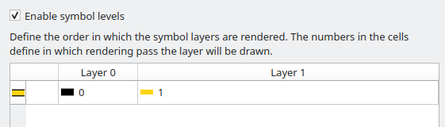

# QGIS Enhancement 432: Cross-layer symbol levels

## Summary

QGIS has long supported the ability to control the rendering order of symbol layers for a single
vector layer. This allows users to configure a vector layer's appearance in such a way that
individual symbol layers from across the vector layer's renderer are rendered one-at-a-time,
in an order explicitly specified by the user. See screenshot below:

This is a very valuable feature for symbology, as it allows creation of things like "cased road"
symbols, where the black outlines are always drawn below the colored part of the road. See illustrations below

With symbol levels:

Without symbol levels:

This functionality is currently restricted ordered rendering within individual layers only. It is not
possible to "mix up" the rendering of symbols across different layers, such that some of symbol layers from
one vector layer are drawn below the symbol layers of a different vector, and others are drawn above them.

This limitation forces users to insert multiple copies of the same layer into their projects, with each
copied filtered to only render a subset of data. It's a messy and fragile way to achieve what should ideally
be possible with just a single copy of the layer in the project alone.

This proposal describes how the symbol level functionality will be extended to permit cross-layer
rendering.

## Proposed Changes

### User interface

Users will be able to have mixed-layer symbol levels for vector layers contained within the same layer group
ONLY. I.e. in the sample project shown below, the user will be able to mix the rendering of symbol layers across
the "_local roads_" and "_highways_" layers only, and NOT mix these with the layers from the "_water lines_" layer.

Additionally, the user must opt-in to setting the layer tree group to "render layers as a group", using the existing
option for this setting from the layer styling panel:

The layer styling dock panel for group layer rendering settings will be extended to add a new widget for
controlling symbol level rendering across the group. The widget will be based off the existing widget 
for controlling symbol levels for a single layer, and have an explicit check box to set whether the
group should be rendered using levels:

This widget will show ALL symbol layers from ALL vector layers contained within the group, so that the user
can specify levels across different vector layers as well as symbol layers.

## API Changes

### Symbology and feature renderer API

No changes will be required here. The underlying API for the symbols already allows setting numeric symbol levels
for all symbol layers without any constraints (eg it allows gaps or repeated symbol layer indices), so this
API already permits us to store and retrieve symbol level values which will work across different vector layers.

### Map renderer job logic

The bulk of the changes will reside in the `QgsMapRendererJob::prepareJobs` method. This is the code responsible
for iterating over the map layers to be rendered, and creating render jobs for each.

Specifically, the iteration logic will be adjusted to insert special logic for when a QgsGroupLayer is encountered,
where that layer has the "enable symbol levels" option enabled. When this is the case, all the child
vector layers from the group will be scanned upfront to determine the full set of symbol level indices
present for all symbols across the entire group, and to store which vector layers have symbol layers with
each symbol level index.

The collected list of all group symbol level indices will then be iterated in order, with individual
QgsVectorLayerRenderer jobs being created as required, each configured to render only a sub-set of symbol levels.
A single vector layer from the group may end up with many QgsVectorLayerRenderer jobs, where each has a different
set of symbol levels to render. Each job will be inserted into the rendering queue at the appropriate place,
so that the subset of symbol levels from that layer will be rendered into the correct order in the stacked
rendered layers.

### GUI API

Much of the GUI API is already available. The `SymbolLayerVisitor` class is able to collect all symbol layers
from a vector layer's renderer, and can be reused for both the renderer job changes and the population of the
aggregated symbol levels widget.

A new widget will be created for configuring cross-vector layer symbol levels, based on the existing
`QgsSymbolLevelsWidget` widget. (The existing widget API is very heavily tied to single-vector layer logic,
and it is part of stable API. It's also not a complicated widget, so introducing a new widget will
not result in significant code bloat).

## Risks

None identified

## Performance Implications

Rendering will be slower when this feature is enabled, as it requires creation of additional
map render jobs. However, this feature is entirely opt-in, so no regression in current rendering
performance for existing projects will result.

## Further Considerations/Improvements

None

## Backwards Compatibility

N/A

## Issue Tracking ID(s)

https://github.com/qgis/QGIS/issues/19895
https://github.com/qgis/QGIS/issues/28814